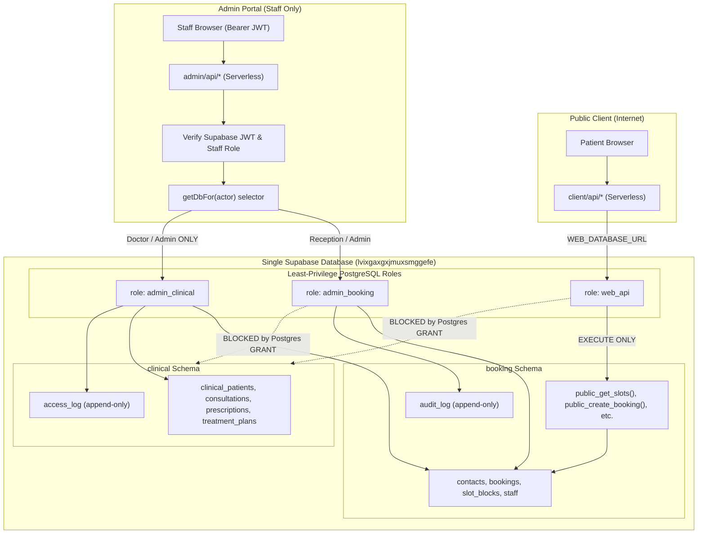

# The Skin Tree: Complete System Architecture & Technical Dossier

> **Clinic Context:** Luxury aesthetic dermatology sanctuary in Bandra West, Mumbai.  
> **Lead Dermatologist:** Dr. Aishwarya Agarwal (MBBS, MD Dermatology).  
> **Target Audience:** Premium clientele seeking evidence-based dermatology, clinical peels, hydrafacials, acne/scar treatments, and laser therapies.  
> **Document Purpose:** Complete end-to-end technical specification to feed into AI assistants (Claude / Anthropic) and engineering teams.

---

## 1. Executive Summary & Core Requirements

The Skin Tree platform consists of two integrated applications backed by a single PostgreSQL database hosted on Supabase:
1. **Public Patient Portal & Booking Website (`client/`):** Luxury static/SPA website with real-time slot booking, AI consultation concierge, and tokenized self-service appointment management.
2. **Staff & Clinical Management Dashboard (`admin/`):** Restricted portal for clinic receptionists, doctors, and clinic administrators to manage appointments, doctor schedules, slot blocks, and confidential electronic medical records (EMR).
3. **Strict Postgres Security Architecture:** Both applications share **ONE** PostgreSQL database, but are strictly isolated into two schemas (`booking` and `clinical`) accessed via **three least-privilege PostgreSQL roles** (`web_api`, `admin_booking`, `admin_clinical`).

---

## 2. PostgreSQL Database Architecture (Single DB, 2 Schemas, 3 Roles)

- **Supabase Project Ref:** `lvixgaxgxjmuxsmggefe`
- **Region:** AWS `ap-northeast-1` (Tokyo)
- **Timezone Standard:** `Asia/Kolkata` strictly enforced in SQL.
- **Connection Model:** Supabase Supavisor Connection Pooler (Port `6543` / `5432`) using `postgres` (porsager) npm package with `prepare: false` and `ssl: 'require'`.

### A. The Three Least-Privilege Roles

| Role Name | Used By | Privileges & Permissions | Strict Denials |
| :--- | :--- | :--- | :--- |
| `web_api` | Public Site & Chatbot (`client/api/*`) | `EXECUTE` only on 5 public functions: `booking.public_get_slots`, `booking.public_create_booking`, `booking.public_manage_get`, `booking.public_manage_cancel`, `booking.public_manage_reschedule`. | **Zero** table access (`SELECT`/`INSERT`/`UPDATE`/`DELETE` denied on all tables). **Zero** access to `clinical` schema. |
| `admin_booking` | Admin Dashboard (Scheduling/Reception) | `SELECT`, `INSERT`, `UPDATE` on `booking.*` tables; `INSERT` on `booking.audit_log`. `EXECUTE` on admin booking functions. | **DELETE** denied on `contacts` and `bookings`. `UPDATE`/`DELETE` denied on `audit_log` (append-only). **Zero** access to `clinical` schema. |
| `admin_clinical` | Admin Dashboard (Doctor EMR only) | `SELECT`, `INSERT`, `UPDATE` on `clinical.*` tables; `INSERT` on `clinical.access_log`. Read-only `SELECT` on `booking.*`. | `UPDATE`/`DELETE` denied on `access_log` (append-only). `INSERT`/`UPDATE`/`DELETE` denied on `booking.*`. |

### B. Connection URIs
```env
# Client (.env.local) - ONLY gets web_api
WEB_DATABASE_URL="postgresql://web_api.lvixgaxgxjmuxsmggefe:<PASSWORD>@aws-0-ap-northeast-1.pooler.supabase.com:6543/postgres?sslmode=require"

# Admin (.env.local) - Gets role-separated credentials
ADMIN_BOOKING_DATABASE_URL="postgresql://admin_booking.lvixgaxgxjmuxsmggefe:<PASSWORD>@aws-0-ap-northeast-1.pooler.supabase.com:6543/postgres?sslmode=require"
ADMIN_CLINICAL_DATABASE_URL="postgresql://admin_clinical.lvixgaxgxjmuxsmggefe:<PASSWORD>@aws-0-ap-northeast-1.pooler.supabase.com:6543/postgres?sslmode=require"
```

### C. Schema 1: `booking` Schema DDL

```sql
create schema if not exists booking;

-- 1. Contacts (Patient identity for booking)
create table booking.contacts (
  id uuid primary key default gen_random_uuid(),
  patient_ref text not null unique, -- E.g. 'TST-2026-XXXX'
  full_name text not null,
  phone text not null,
  email text,
  consent_given boolean not null default false,
  consent_timestamp timestamptz,
  notes text,
  created_at timestamptz not null default now(),
  updated_at timestamptz not null default now()
);

-- 2. Bookings (Appointments)
create table booking.bookings (
  id uuid primary key default gen_random_uuid(),
  contact_id uuid not null references booking.contacts(id) on delete restrict,
  treatment text not null,
  appointment_date date not null,
  appointment_time time not null,
  status text not null default 'pending' check (status in ('pending', 'confirmed', 'completed', 'cancelled', 'no_show')),
  source text not null check (source in ('website_form', 'ai_chat', 'admin_manual', 'phone', 'walk_in')),
  manage_token text not null unique,
  idempotency_key text,
  cancellation_reason text,
  cancelled_at timestamptz,
  created_at timestamptz not null default now(),
  updated_at timestamptz not null default now()
);

-- Concurrency double-booking guard: Partial unique index
create unique index one_active_booking_per_slot
  on booking.bookings (appointment_date, appointment_time)
  where status in ('pending', 'confirmed');

-- 3. Slot Blocks (Doctor schedule unavailability)
create table booking.slot_blocks (
  id uuid primary key default gen_random_uuid(),
  block_date date not null,
  start_time time not null,
  end_time time not null,
  reason text,
  created_by uuid,
  created_at timestamptz not null default now()
);

-- 4. Staff Accounts
create table booking.staff (
  id uuid primary key default gen_random_uuid(),
  user_id uuid not null unique, -- Supabase Auth User ID
  email text not null unique,
  full_name text not null,
  role text not null check (role in ('admin', 'doctor', 'reception')),
  is_active boolean not null default true,
  created_at timestamptz not null default now()
);

-- 5. Audit Log (Append-only)
create table booking.audit_log (
  id bigint generated always as identity primary key,
  staff_id uuid,
  action text not null,
  target_type text,
  target_id text,
  details jsonb not null default '{}'::jsonb,
  created_at timestamptz not null default now()
);
```

### D. Schema 2: `clinical` Schema DDL

```sql
create schema if not exists clinical;

-- 1. Clinical Patients (Strict 1-to-1 foreign key to booking contact)
create table clinical.clinical_patients (
  id uuid primary key default gen_random_uuid(),
  patient_ref text not null unique references booking.contacts(patient_ref) on delete restrict,
  allergies text[] not null default '{}',
  skin_type text check (skin_type in ('I', 'II', 'III', 'IV', 'V', 'VI')),
  fitzpatrick_scale int check (fitzpatrick_scale between 1 and 6),
  medical_alerts text,
  created_at timestamptz not null default now(),
  updated_at timestamptz not null default now()
);

-- 2. Consultations (Confidential doctor charts)
create table clinical.consultations (
  id uuid primary key default gen_random_uuid(),
  patient_id uuid not null references clinical.clinical_patients(id) on delete restrict,
  doctor_id uuid not null references booking.staff(id),
  booking_id uuid references booking.bookings(id),
  consultation_date date not null default (now() at time zone 'Asia/Kolkata')::date,
  chief_complaint text not null,
  clinical_examination text,
  diagnosis text not null,
  differential_diagnosis text,
  clinical_notes text,
  follow_up_instructions text,
  follow_up_date date,
  created_at timestamptz not null default now(),
  updated_at timestamptz not null default now()
);

-- 3. Prescriptions & Products
create table clinical.prescriptions (
  id uuid primary key default gen_random_uuid(),
  consultation_id uuid not null references clinical.consultations(id) on delete cascade,
  medication_name text not null,
  dosage text not null,
  frequency text not null,
  duration text not null,
  instructions text,
  created_at timestamptz not null default now()
);

-- 4. Treatment Plans
create table clinical.treatment_plans (
  id uuid primary key default gen_random_uuid(),
  consultation_id uuid not null references clinical.consultations(id) on delete cascade,
  procedure_name text not null,
  planned_sessions int not null default 1,
  completed_sessions int not null default 0,
  intervals_weeks int,
  special_precautions text,
  status text not null default 'active' check (status in ('active', 'completed', 'discontinued')),
  created_at timestamptz not null default now()
);

-- 5. Clinical Access Log (Append-only HIPAA-grade audit)
create table clinical.access_log (
  id bigint generated always as identity primary key,
  doctor_id uuid not null references booking.staff(id),
  patient_id uuid references clinical.clinical_patients(id),
  action text not null,
  accessed_fields text[] not null default '{}',
  created_at timestamptz not null default now()
);
```

### E. Concurrency & Double-Booking Guard
Slots are locked using a two-tier mechanism:
1. **Application-level Advisory Lock:** `pg_advisory_xact_lock(hashtext('booking_lock_' || p_date::text || '_' || p_time::text))` inside `booking.public_create_booking`.
2. **Postgres Storage Engine Level:** Partial unique index `one_active_booking_per_slot` on `(appointment_date, appointment_time)` where `status in ('pending', 'confirmed')`.
Verified with 10 concurrent parallel requests: exactly 1 acquires the slot, 9 receive `409 Conflict`.

---

## 3. Application Directory Structure

```
Theskintree/
├── client/                     # Public Website & Booking API (Root for Vercel Client)
│   ├── api/                    # Vercel Serverless Functions
│   │   ├── bookings.js         # POST /api/bookings (Create booking)
│   │   ├── slots.js            # GET /api/slots (Live slot availability)
│   │   ├── chat.js             # POST /api/chat (AI Concierge with tool calling)
│   │   └── manage.js           # GET/POST /api/manage (Tokenized cancel/reschedule)
│   ├── src/                    # React 18 SPA
│   │   ├── components/         # Hero, Doctor, Treatments, BookingModal, ChatWidget
│   │   ├── pages/              # ManageBooking.jsx
│   │   └── styles/             # Luxury typography, terracotta accents, components.css
│   ├── vite.config.js          # Vite configuration with local SSR API middleware
│   └── package.json
│
├── admin/                      # Staff & Doctor Clinical Portal (Root for Vercel Admin)
│   ├── api/                    # Vercel Serverless Functions (Staff Auth Guarded)
│   │   ├── [...path].js        # Wildcard router for /api/admin/* and /api/clinical/*
│   │   └── cron/               # reminders.js, keepalive.js
│   ├── server/                 # Node.js backend domain layer
│   │   ├── clinical/           # OOP EMR: PatientRecordService, ClinicalStore, models/
│   │   └── lib/                # db.js (getDbFor actor selector), auth.js, audit.js
│   ├── src/                    # React 18 Admin Dashboard
│   │   ├── context/            # AuthContext (Supabase Auth token management)
│   │   ├── pages/              # Dashboard, Appointments, ClinicalCharts, PatientDetail
│   │   └── components/         # AccessLogTable, SlotBlockerModal
│   ├── vite.config.js          # Vite with staff API emulation
│   └── package.json
│
├── shared/                     # Pure JS domain constants, DTOs, validations
│   ├── config.js               # Clinic hours (Mon-Sat 09:00-16:00, 12h advance rule)
│   ├── dtos.js                 # ReminderDTO (zero medical diagnosis fields)
│   └── validation.js
│
├── scripts/                    # Automated Verification Suites
│   ├── db-privilege-test.mjs   # 16 Postgres boundary tests across 3 roles
│   ├── race-test.mjs           # 10-way parallel race condition test
│   ├── unit-tests.mjs          # OOP clinical security & DTO unit tests
│   └── check-isolation.mjs     # AST/Grep boundary test (0 CLINICAL in client/)
└── supabase/
    └── schema.sql              # Unified production database migration
```

---

## 4. Security & Isolation Architecture



### Strict Isolation Rules Verified by Scripts:
1. `client/` codebase contains **ZERO** references to `clinical`, `ADMIN_`, or Supabase service keys (`check-isolation.mjs`).
2. Reception staff cannot construct `PatientRecordService` or access `clinical` DB (`ForbiddenError` thrown).
3. `ReminderDTO` sanitizes all output sent to external notification services (guaranteed 0 diagnostic or medication fields).
4. `audit_log` and `access_log` have `REVOKE UPDATE, DELETE` applied directly in Postgres, creating immutable tamper-proof logs.

---

## 5. The AI Concierge & Latency Bottleneck Analysis

### A. Current Implementation ([`client/api/chat.js`](file:///home/adi/Theskintree/client/api/chat.js))
The chatbot uses Google Gemini (`generativelanguage.googleapis.com/v1beta`) with **Function Calling** enabled:
1. `check_availability({ date })`: Calls `booking.public_get_slots` to inspect live doctor slots.
2. `create_booking({ name, phone, treatment, date, time, consent })`: Calls `booking.public_create_booking` to create a confirmed appointment.

### B. Root Causes of High Latency (>10 seconds)

1. **Multi-Turn Round Trip Serialization:**
   When a user asks: *"What treatments do you have for pigmentation and are there slots tomorrow?"*
   - **Step 1 (Gemini Turn 1):** Model receives message, generates `functionCall: check_availability(date="2026-10-28")` (~2.5s).
   - **Step 2 (Database Query):** Server connects to Tokyo Supabase Pooler (`aws-0-ap-northeast-1.pooler.supabase.com`), executes SQL function `booking.public_get_slots`, and parses response (~1.5s - 2.5s cross-continent).
   - **Step 3 (Gemini Turn 2):** Server sends tool output back to Gemini. Gemini synthesizes conversational answer (~2.5s).
   - **Total sequential latency:** 2.5s + 2.0s + 2.5s = **7 to 10+ seconds**.

2. **Non-Streaming HTTP Response:**
   The client makes a standard `fetch('/api/chat', { method: 'POST' })` and awaits the full JSON body. The browser spinner runs for the entire duration with zero incremental feedback.

3. **Cross-Continent Database Latency:**
   The Supabase project was created in Tokyo (`ap-northeast-1`), while local development and users are connecting from India / Mumbai (`Asia/Kolkata`). Each SQL connection over TLS across continents adds 200–400ms TCP/TLS round trip overhead.

4. **Model Architecture Overhead:**
   Gemini preview models (`gemini-3.1-flash-lite`, `gemini-3.5-flash`) incorporate internal reasoning chains. Older models like `gemini-2.5-flash` were recently deprecated by Google with HTTP 404 responses.

---

## 6. Architecture Solutions to Feed into Claude / Engineering

### Solution 1: Streaming Server-Sent Events (SSE)
Instead of waiting for the full 10 seconds:
- Convert `/api/chat` to an SSE stream (`Content-Type: text/event-stream`).
- While tool execution is taking place in Step 2, emit an immediate UI event: `event: status, data: "Checking Dr. Aishwarya's schedule..."`.
- Stream the final tokens word-by-word.
- **Perceived latency drops from 10s to <600ms**.

### Solution 2: Decoupled UI-Driven Booking Flow
- Do not make Gemini call the database for slot availability in the conversation loop.
- When user intent is to book, Gemini emits a structured event: `{ ui: "open_slot_picker", treatment: "Pigmentation" }`.
- The browser frontend fetches `/api/slots` directly from the lightweight REST endpoint (~200ms) and presents the interactive date/time chips.
- Gemini only handles conversational guidance; database transactions are triggered by direct user interaction or single-shot tool calls.

### Solution 3: Direct Anthropic Claude 3.5 Haiku / Sonnet Engine
Claude 3.5 Haiku provides industry-leading tool-calling speeds (<800ms) with high adherence to strict privacy instructions:
- Can replace Gemini in `client/api/chat.js` using `@anthropic-ai/sdk`.
- Strict system prompt enforcement of Dr. Aishwarya Agarwal's clinical boundaries.

---

## 7. Key Configuration & Credentials Reference

- **Doctor Lead:** Dr. Aishwarya Agarwal (MBBS, MD Dermatology)
- **Clinic Location:** The Skin Tree Sanctuary, Bandra West, Mumbai 400050
- **Primary Timezone:** `Asia/Kolkata` (UTC+05:30)
- **Clinic Hours:** Monday to Saturday: 09:00 – 16:00. Sunday: Closed.
- **Advance Booking Window:** Minimum 12 hours advance booking required; maximum 60 days.
- **Admin Login:** `admin@theskintree.in` / `SkinTree@Admin2026!`
- **Database Ref:** `lvixgaxgxjmuxsmggefe` (`aws-0-ap-northeast-1.pooler.supabase.com:6543`)
