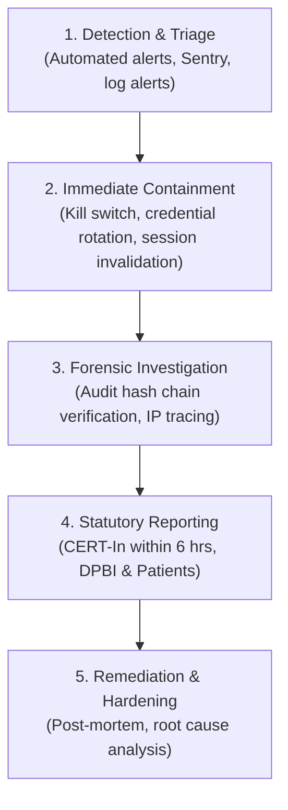

# Cyber Security Breach Response & Incident Management Protocol

**Clinic:** The Skin Tree (Bandra West, Mumbai)  
**Lead Doctor:** Dr. Aishwarya Agarwal, MBBS, MD Dermatology  
**Regulatory Framework:**
- CERT-In Directions under Subsection (6) of Section 70B of the Information Technology Act, 2000 (Mandatory 6-Hour Reporting)
- Section 8(6) of the Digital Personal Data Protection Act, 2023 (DPDP Act 2023)
- Indian Medical Council (Professional Conduct, Etiquette and Ethics) Regulations, 2002

---

## 1. Incident Severity Classification Matrix

| Severity Level | Definition | Impact | Mandatory Escalation |
| :--- | :--- | :--- | :--- |
| **P1 - Critical** | Unauthorized access, exfiltration, or modification of `clinical` schema (medical diagnoses, consultation notes, prescriptions, doctor notes). | Direct violation of doctor-patient confidentiality; potential patient health harm. | **Immediate (0-2 hours):** Clinic Lead (Dr. Aishwarya Agarwal), Legal Counsel, CERT-In, DPBI. |
| **P2 - High** | Exfiltration or unauthorized access to `booking` contacts (patient names, phone numbers, booking tokens) or compromised staff admin account. | Patient privacy compromise; identity theft or targeted spam risk. | **Within 6 hours:** Legal Counsel, CERT-In, affected patients. |
| **P3 - Medium** | Denial of Service (DoS) attack, credential stuffing against public endpoints, broken rate-limiter, or failed unauthorized SQL attempt. | Temporary scheduling downtime; zero data exfiltration. | **Within 24 hours:** Security Lead, infrastructure review. |

---

## 2. 5-Phase Incident Response Lifecycle



### Phase 1: Detection & Triage (Minutes 0 - 15)
1. **Trigger Sources:**
   - Supabase connection anomaly or spike in rejected connection attempts.
   - Failure detected by `scripts/verify-audit-chain.mjs` (tampering in audit logs).
   - Vercel DDoS/WAF alerts or rate-limiting thresholds exceeded.
   - Staff report of suspicious admin login or MFA bypass attempt.
2. **Action:**
   - Incident Commander (Clinic Administrator / Lead Tech) declares active P1/P2 incident.
   - Establish dedicated incident response channel.

### Phase 2: Immediate Containment (Minutes 15 - 45)
1. **Revoke Active Credentials:**
   - In Supabase SQL Editor:
     ```sql
     -- Rotate custom role passwords immediately
     ALTER ROLE web_api WITH PASSWORD '<EMERGENCY_ROTATED_PASSWORD_1>';
     ALTER ROLE admin_booking WITH PASSWORD '<EMERGENCY_ROTATED_PASSWORD_2>';
     ALTER ROLE admin_clinical WITH PASSWORD '<EMERGENCY_ROTATED_PASSWORD_3>';
     ```
   - In Supabase Dashboard: **Authentication** → Revoke all active staff sessions and refresh tokens.
2. **Isolate Compromised Endpoints:**
   - If public booking API is compromised: Enable Vercel maintenance mode or rate-limit clamping.
   - If staff account is compromised: Set `booking.staff.active = false` immediately in database:
     ```sql
     UPDATE booking.staff SET active = false WHERE user_id = '<COMPROMISED_STAFF_UUID>';
     ```
3. **Preserve Forensic Evidence:**
   - Take read-only snapshot of database (`clinical.access_log` and `booking.audit_log`).
   - Export Vercel function invocation logs and Supavisor pooler access logs.

### Phase 3: Forensic Analysis & Hash Chain Verification (Hours 1 - 3)
1. **Execute Cryptographic Verification:**
   ```bash
   node scripts/verify-audit-chain.mjs
   ```
   - If verification returns `PASS`: Zero audit rows were altered or removed.
   - If verification returns `TAMPER DETECTED at row X`: Identify the exact timestamp, actor, and targeted patient UUID.
2. **Determine Scope of Breach:**
   - Query `clinical.access_log` for the suspect actor/IP to identify all accessed medical records.
   - Query `booking.bookings` for any unauthorized cancellations or modifications.

### Phase 4: Mandatory Statutory Notifications (Hours 3 - 6)

#### A. CERT-In Notification (Mandatory within 6 Hours)
Under CERT-In Cyber Security Directions (No. 20(3)/2022-CERT-In), report the incident within 6 hours of discovery:
- **Email:** `incident@cert-in.org.in`
- **Phone:** 1800-11-4949 / +91-11-24669949
- **Required Details:**
  1. Name of entity: The Skin Tree (Mumbai, India)
  2. Type of incident: Unauthorized Access / Medical Data Exposure
  3. Date and time of incident detection (IST)
  4. Affected systems and geographical location (AWS Mumbai / Supabase)
  5. Impact assessment (Number of affected records, clinical vs demographic)
  6. Containment and remediation actions taken

#### B. Data Protection Board of India (DPBI) Notification
Under Section 8(6) of DPDP Act 2023:
- Submit formal notice detailing:
  - Nature and extent of personal data breached.
  - Potential consequences for Data Principals.
  - Measures implemented to mitigate risks.
  - Contact details of Grievance Officer.

#### C. Patient (Data Principal) Notification
In the event of P1 (clinical) or P2 (demographic) data exposure:
- Dispatch individual SMS / WhatsApp and email notifications within 24 hours of containment:
```text
Important Notice from The Skin Tree regarding your consultation data:
Dear Patient, We are writing to inform you of a security incident detected on [Date]. 
Our medical security controls isolated the issue within [X] minutes. 
Your consultation history remains protected under encryption. 
As a precautionary measure, your appointment management links have been regenerated. 
For assistance or questions, please contact our Data Protection Lead at privacy@theskintree.in or +91 98200 12345.
- Dr. Aishwarya Agarwal, Lead Dermatologist
```

### Phase 5: Post-Incident Remediation & Prevention
1. Re-run complete test suite:
   ```bash
   npm run check:isolation
   npm run test:unit
   node scripts/db-privilege-test.mjs
   node scripts/verify-audit-chain.mjs
   ```
2. Update firewall / WAF rules to block malicious IP subnets.
3. Conduct comprehensive architectural review and publish incident post-mortem within 14 days.
