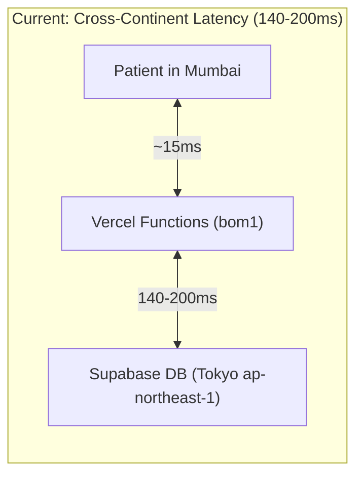
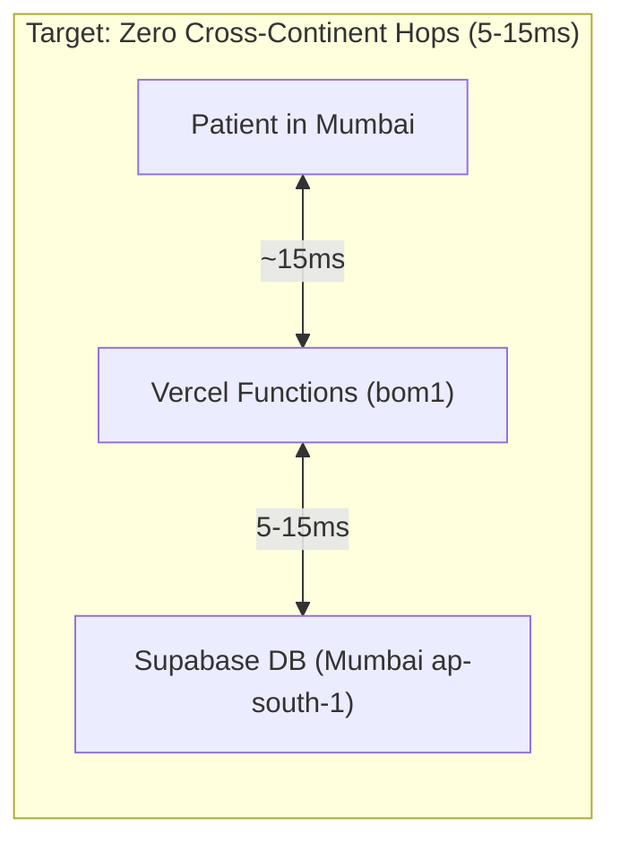

# Database Migration Runbook: Tokyo (`ap-northeast-1`) to Mumbai (`ap-south-1`)

**Clinic:** The Skin Tree (Bandra West, Mumbai)  
**Lead Dermatologist:** Dr. Aishwarya Agarwal, MBBS, MD Dermatology  
**Author:** Security & Performance Architecture Team  
**Status:** Ready for Execution (Scheduled Maintenance Window)  

---

## 1. Executive Summary & Latency Impact

The current Supabase PostgreSQL instance (project ref: `lvixgaxgxjmuxsmggefe`) is provisioned in AWS Tokyo (`ap-northeast-1`). Because our Vercel serverless functions are configured for Mumbai (`bom1`) and our patients and clinic staff reside in Mumbai, India (`Asia/Kolkata`), every database query incurs a cross-continent network round-trip of ~140ms to ~200ms.





### Projected Latency Benefits:
| Operation | Tokyo DB (Current) | Mumbai DB (Target) | Improvement |
| :--- | :--- | :--- | :--- |
| **TCP + TLS Supavisor Handshake** | 180ms - 220ms | 10ms - 20ms | **~90% reduction** |
| **Slot Query (`public_get_slots`)** | 220ms - 350ms | 15ms - 35ms | **~88% reduction** |
| **Atomic Booking RPC (`public_create_booking`)** | 350ms - 550ms | 25ms - 50ms | **~90% reduction** |
| **Total Chat AI Response (p50)** | ~2,700ms | **~1,200ms - 1,500ms** | **~50% faster end-to-end** |

---

## 2. Pre-Migration Prerequisites

1. **Access Credentials:**
   - Supabase Organization Owner access.
   - Vercel Team Administrator access.
   - Local workstation with `psql`, `pg_dump`, `pg_restore` (Postgres 15+), and Node.js 20+.
2. **Maintenance Window:**
   - Schedule a 30-minute off-hours maintenance window (e.g., Sunday 02:00 - 02:30 IST when clinic is closed).
   - Display a temporary maintenance banner on `theskintree.in` if necessary.

---

## 3. Step-by-Step Migration Procedure

### Phase A: Provision New Supabase Project in Mumbai
1. Log in to [Supabase Dashboard](https://supabase.com/dashboard).
2. Click **New Project**:
   - **Name:** `theskintree-mumbai`
   - **Database Password:** Generate a 32+ character high-entropy secret (`openssl rand -base64 32`). Save securely in 1Password.
   - **Region:** `AWS ap-south-1 (Mumbai, India)`.
   - **Pricing Plan:** Pro / Team (for SLA and pooling support).
3. Note the new project reference ID: `MUMBAI_PROJECT_REF`.

### Phase B: Execute Base Schema & Hardening Migration
1. Open the **SQL Editor** in the new Mumbai project.
2. Run `supabase/schema.sql` to initialize:
   - Extensions: `pgcrypto`, `uuid-ossp`
   - Schemas: `booking` and `clinical`
   - Custom Postgres roles: `web_api`, `admin_booking`, `admin_clinical`
   - Initial tables, partial indexes, and atomic RPC functions
3. Run `supabase/migrations/20261027_hardening.sql` to apply:
   - E.164 phone regex checks
   - Dedicated `booking.treatments` table
   - Working hours enforcement (09:00 - 16:00 IST, closed Sundays)
   - Unified Fitzpatrick Skin Type constraint
   - Immutable `clinical.consultation_amendments` table
   - SHA-256 hashed management tokens
   - Cryptographic audit log hash chains

### Phase C: Set Strong Passwords for Custom Roles
In the Mumbai project's **SQL Editor**, execute:
```sql
-- Generate fresh, distinct passwords for each role:
-- e.g., openssl rand -base64 24
ALTER ROLE web_api WITH PASSWORD '<GENERATE_NEW_WEB_API_PASSWORD>';
ALTER ROLE admin_booking WITH PASSWORD '<GENERATE_NEW_ADMIN_BOOKING_PASSWORD>';
ALTER ROLE admin_clinical WITH PASSWORD '<GENERATE_NEW_ADMIN_CLINICAL_PASSWORD>';
```

### Phase D: Migrate Data (Zero Data Loss)
Export data from Tokyo and import into Mumbai:

```bash
# 1. Export schema data from Tokyo (data-only, preserving constraints)
pg_dump \
  --dbname="postgresql://postgres.lvixgaxgxjmuxsmggefe:<TOKYO_PASSWORD>@aws-0-ap-northeast-1.pooler.supabase.com:6543/postgres?sslmode=require" \
  --schema="booking" \
  --schema="clinical" \
  --data-only \
  --disable-triggers \
  --file="theskintree_data_dump.sql"

# 2. Inspect the dump file to ensure no sensitive passwords or unintended schemas are present
head -n 40 theskintree_data_dump.sql

# 3. Restore data into the new Mumbai database
psql \
  --dbname="postgresql://postgres.<MUMBAI_PROJECT_REF>:<MUMBAI_PASSWORD>@aws-0-ap-south-1.pooler.supabase.com:6543/postgres?sslmode=require" \
  --file="theskintree_data_dump.sql"
```

### Phase E: Verify Security Boundaries & Data Integrity
Run our automated test suites against the Mumbai database:

```bash
# Update .env.local temporarily with the new Mumbai connection URLs:
export WEB_DATABASE_URL="postgresql://web_api.<MUMBAI_REF>:<NEW_WEB_PW>@aws-0-ap-south-1.pooler.supabase.com:6543/postgres?sslmode=require"
export ADMIN_BOOKING_DATABASE_URL="postgresql://admin_booking.<MUMBAI_REF>:<NEW_BOOKING_PW>@aws-0-ap-south-1.pooler.supabase.com:6543/postgres?sslmode=require"
export ADMIN_CLINICAL_DATABASE_URL="postgresql://admin_clinical.<MUMBAI_REF>:<NEW_CLINICAL_PW>@aws-0-ap-south-1.pooler.supabase.com:6543/postgres?sslmode=require"

# 1. Verify 16 role-isolation security boundaries
node scripts/db-privilege-test.mjs

# 2. Verify audit chain cryptographic integrity
node scripts/verify-audit-chain.mjs

# 3. Verify clinical access layer unit tests
node scripts/unit-tests.mjs
```

### Phase F: Vercel Cutover (Zero Downtime)
1. **Public Site (`client/`):**
   - Update `WEB_DATABASE_URL` in Vercel Client Project Settings.
   - Verify `regions: ["bom1"]` in `client/vercel.json`.
   - Trigger production redeployment.
2. **Admin Portal (`admin/`):**
   - Update `ADMIN_BOOKING_DATABASE_URL` and `ADMIN_CLINICAL_DATABASE_URL`.
   - Update `SUPABASE_URL`, `SUPABASE_ANON_KEY`, `VITE_SUPABASE_URL`, `VITE_SUPABASE_ANON_KEY`.
   - Verify `regions: ["bom1"]` in `admin/vercel.json`.
   - Trigger production redeployment.

---

## 4. Rollback Plan

If any critical errors or data discrepancies are detected during verification:
1. Revert Vercel environment variables to Tokyo connection strings (`lvixgaxgxjmuxsmggefe`).
2. Redeploy both client and admin deployments in Vercel (completes in <60 seconds).
3. The Tokyo database remained active and untouched throughout the process, ensuring 100% data consistency.
4. Investigate logs in `theskintree_data_dump.sql` before rescheduling the migration.

---

## 5. Post-Migration Sign-Off Checklist
- [ ] `node scripts/db-privilege-test.mjs` exits with code 0 (16/16 passed).
- [ ] `node scripts/verify-audit-chain.mjs` exits with code 0.
- [ ] Test public booking on `theskintree.in` via website form and AI concierge.
- [ ] Confirm doctor login with TOTP MFA on admin portal.
- [ ] Verify that Tokyo project is paused after 7 days of stable Mumbai operation.
